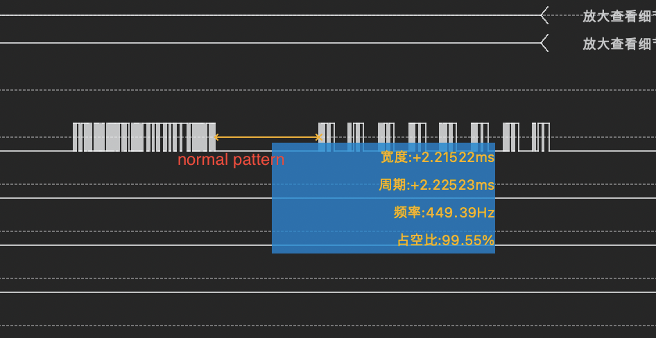
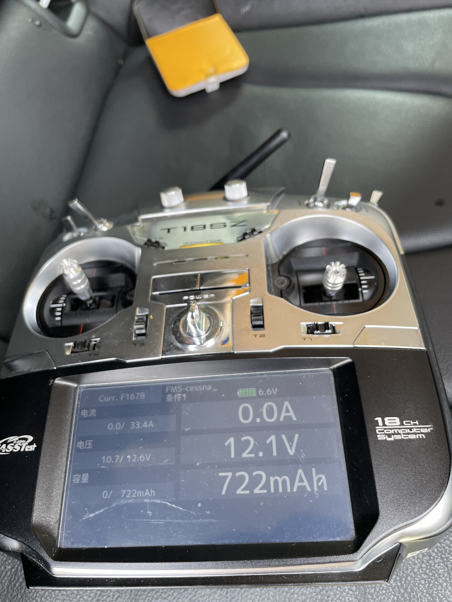
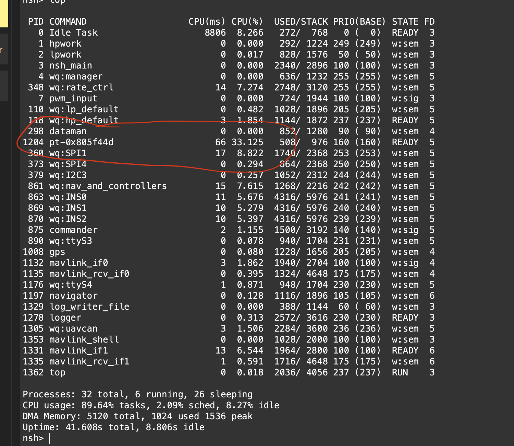
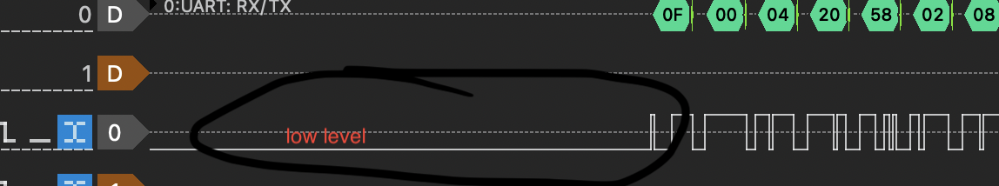
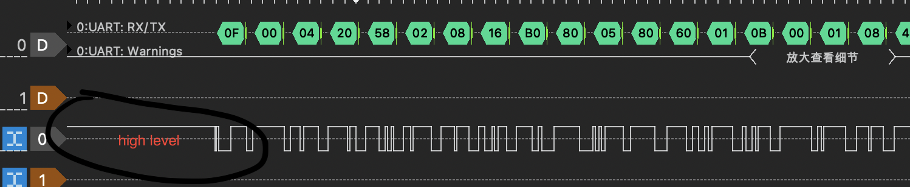
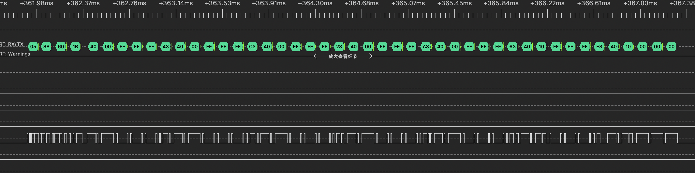
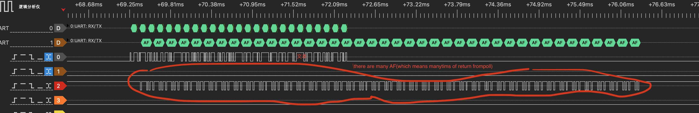
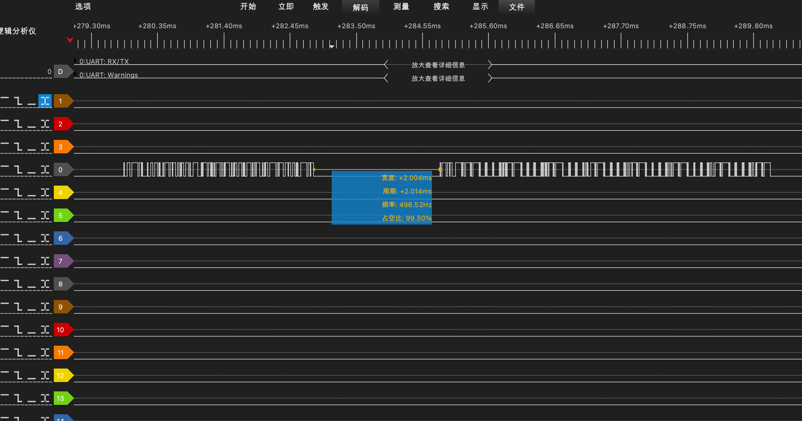
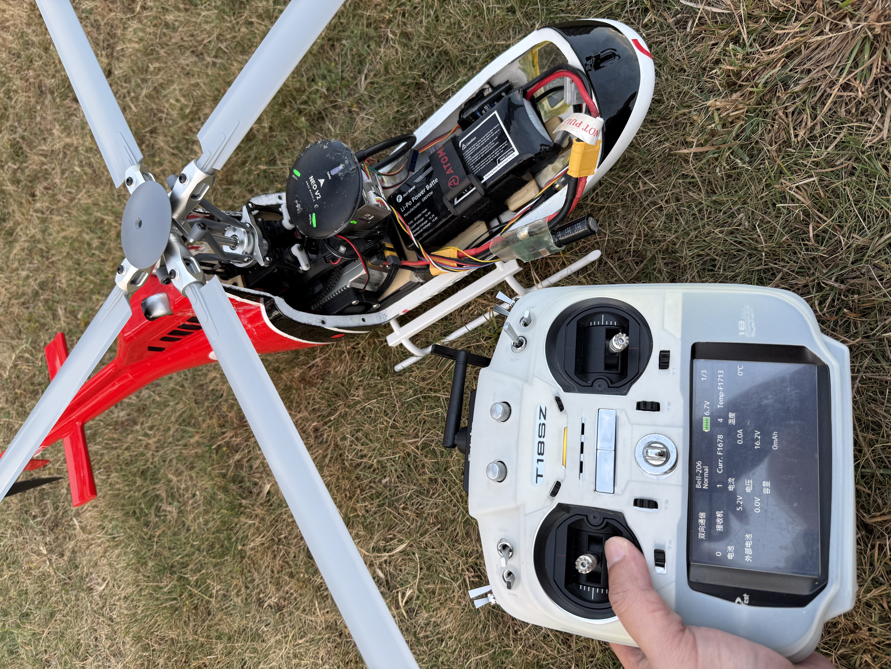

PX4-Custom-Projects/PROJECT_01_SBUS2.txt

# =========================================
# Futaba S.BUS2 Telemetry Support for PX4
# =========================================

## Why I Started This Project

This project started from a very practical reason.

I crashed two aircraft because I could not get battery information from my Futaba transmitter in time.

I am a long time Futaba user and most of my aircraft use a Futaba T18SZ transmitter. I wanted to display battery voltage, GPS data, RPM and later jet engine information directly on the radio.

Unfortunately PX4 did not support Futaba S.BUS2 telemetry, so I started working on it myself.

----------------------------------------------------

## Protocol Information

I did not reverse engineer the S.BUS2 protocol.

After some searching, I found an Arduino project which had already decoded the protocol and published the basic information.

## S.BUS2 Timing Requirements

The protocol itself was already available from public sources.

The challenge of this project was not understanding the protocol, but integrating it into PX4.

### Several characteristics of S.BUS2 made the implementation difficult:

- S.BUS2 uses an inverted UART signal.
- Communication runs at 100000 baud, 8E2.
- Telemetry transmission shares the same single-wire connection used by RC data.
- After a valid S.BUS2 frame is received, the first telemetry slot must be transmitted approximately 2 ms after the end of the frame.
- Consecutive telemetry slots must be be transmitted at intervals of approximately 660 µs.
- Timing errors of only a few hundred microseconds can cause telemetry packets to be ignored by the receiver.

#### A simplified timing diagram looks like this:

S.BUS2 Frame->

Frame End->

~2 ms->

Slot 0->

~660 µs->

Slot 1->

~660 µs->

Slot 2->

...

These timing requirements became the primary engineering challenge of this project.

The protocol format itself was already known.

Generating telemetry responses with sufficient timing accuracy inside PX4 was the difficult part.

The challenge was not understanding the protocol itself.

The real challenge was integrating it into PX4.

----------------------------------------------------

## First Attempt

My first idea was simple.

I thought if Arduino could do it, a STM32F7 flight controller should also be able to do it.

At first I tried using PX4 APIs usleep() and write() calls to send telemetry packets.

Very quickly I discovered that the timing requirements of S.BUS2 were much stricter than I expected.

The telemetry response must be sent about 2 ms after an RC frame is received. The timing tolerance is in the microsecond range.

Using normal PX4 APIs and functions such as usleep() did not work.

The actual timing jitter could be much larger than expected.

----------------------------------------------------

## Register-Based Version

Since the API approach failed, I started reading STM32 datasheets and eventually moved to a register-based implementation.

This version used:

- UART idle interrupt
- Hardware timers
- Direct register access
- Direct UART transmit register writes

To be honest, I already knew this was not an elegant solution.

But at that time I could not find another way.

The good thing was that it worked.

[real flight test with sbus2 telemetry 1](https://youtube.com/shorts/fhSbBsJG8Fo?feature=share)

[real flight test with sbus2 telemetry 2](https://youtube.com/shorts/qmpKLHTjRKw?feature=share)

I successfully displayed telemetry data on my Futaba T18SZ.

----------------------------------------------------

### CPU Usage Problem

After flying with it for some time, another problem appeared.

The project worked, but the CPU usage was terrible.

S.BUS2 telemetry uses 32 slots and each slot contains 3 bytes.

The implementation generated a large number of interrupts.

Eventually I found that the telemetry task alone consumed about 30 percent of the CPU time.

For a flight controller this was unacceptable.

The feature worked, but it was not something I wanted to keep.

----------------------------------------------------

## F7 To H7 Migration

Around the same period the PX4 ecosystem gradually moved from F7 based controllers to H7 platforms.

I started testing on:

- CUAV X7
- Cube Orange
- Holybro boards

The register-based implementation became difficult to maintain because F7 and H7 use different hardware definitions.

I could still deal with that using conditional compilation.

What I could not solve was the signal inversion issue.

S.BUS uses an inverted UART signal.

My original implementation relied on the hardware inversion available on FMUv5 flight controllers.

When I started testing newer H7 flight controllers, this assumption was no longer valid.

As a result, the UART idle detection mechanism stopped working reliably.

At that point I started feeling stuck.

### FMU-V5's hardware-invertd RC signal:

### H7's non-inverted RC signal:

My UART idle interrupt logic completely broke.

At that point I started feeling stuck.

----------------------------------------------------

## Discussions With Daniel Agar

During this period I discussed the problem many times with Daniel Agar on Discord, who is one of the core maintainers of PX4.

I am in China and he is in the US, so many of those discussions happened very late at night for me.

Daniel suggested that I should stop depending on register-level implementations and try using PX4 APIs and threads instead.

At that time I did not even know how PX4 threads were implemented.

It felt like restarting the whole project from scratch.

Still, I decided to follow his advice.

----------------------------------------------------

## PX4 Thread-Based Version

The new design used a dedicated high-priority thread.

Instead of trying to detect the exact frame end using hardware interrupts, I simply polled the RC input port.

Since the RC frames are generated at a fixed interval, I could estimate the telemetry transmission timing by recording when a frame arrived and scheduling the response afterwards.

The idea worked surprisingly well.

However another problem appeared.

S.BUS2 uses a single-wire connection.

The telemetry data I sent out could trigger the polling logic again.

This created feedback problems and took a lot of time to tune and debug.

Eventually I managed to find timing parameters that worked reliably.

#### a normal sbus2 RC-telemetry frame produced by PX4's APIs:

----------------------------------------------------

## Current Result

The final implementation:

- Works on STM32F7
- Works on STM32H7
- Supports Futaba T18SZ telemetry
- Has been used in real aircraft for several years

CPU usage was reduced from approximately 30 percent to approximately 10 percent.

I still use it on all of my PX4 F7/H7 equipped aircraft today. Such as my big cessna,my 450 helicopter,my FPV fixed wing,my jet, etc...

[real flight test on helicopter](https://youtube.com/shorts/wCi05SJgJ0M?feature=share)

----------------------------------------------------

## What I Learned

This project taught me that making something work is only the beginning.

Making it maintainable, portable and reliable is much harder.

The protocol itself was not the hardest part.

The hardest part was repeatedly throwing away designs that already worked and replacing them with better ones.

----------------------------------------------------

## Special Thanks

Special thanks to Daniel Agar.

His suggestions helped me move away from my original register-based implementation and pushed me toward a solution that fits much better into the PX4 architecture.

Without those discussions, this project would probably not look the way it does today.

[def]: img/sbus2/norm.png
