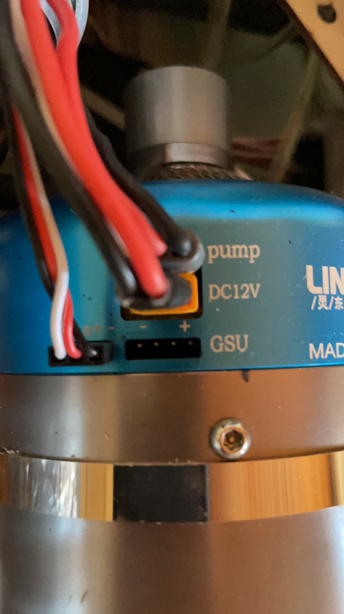

# =================================================
# Jet Engine ECU Integration for PX4
# =================================================

## Why I Started This Project

I have always been interested in jet powered UAVs.

At that time I purchased a Linton jet engine and wanted to integrate it into PX4 directly instead of using a standalone ground control unit.

My goal was not only to control the engine, but eventually to make the engine a native part of the PX4 system.

-------------------------------------------------

## Version 1 - PWM Control

The very first jet engine I tested:

Jet engines usually support two control methods:

- PWM Control
- Serial Protocol Control

I started with PWM because it was the simplest solution.

I created a JetEngine module inside PX4.

The module subscribed to the throttle uORB topic and generated the startup sequence required by the ECU.

The startup sequence was:

Throttle Min
->
Throttle Max
->
Throttle Idle

Once this sequence was completed, the ECU handled:

- Starter Motor
- Fuel Pump
- Ignition
- Engine Start

This version successfully started and controlled the engine.

[PX4 Jet Engine Driver version1-PWM controlling](https://youtube.com/shorts/b6SpqTBijHo?feature=share)

-------------------------------------------------

The First Problem

Although the engine could be controlled, I was not satisfied.

I could send commands to the ECU, but I had no idea what the engine was doing internally.

I could not see:

- RPM
- EGT
- ECU Status
- Warnings
- Error Codes

This meant the system was operating almost completely open-loop.

More importantly, I did not feel that I was really controlling the engine. I could send commands to it, but I knew nothing about its real-time internal state.

For me, this was not real integration.

-------------------------------------------------

## Version 2 - ECU Telemetry

After contacting the Linton manufacturer, I obtained the communication protocol between the ECU and the GSU.

The ECU continuously transmitted engine telemetry data after power up.

This made the implementation relatively straightforward.

I created:

je_status.msg

to publish engine information into the PX4 system.

The architecture became:

ECU
->
WorkQueue
->
Read Serial Data
->
Protocol Parser
->
je_status.msg
->
uORB Publish

This was the first time I began working with:

- WorkQueue
- uORB
- Custom PX4 Messages

[PX4 Jet Engine Driver version2-with ECU'scomunication protocol-developing](https://youtube.com/shorts/uKYuPyGovpY?feature=share)

[PX4 Jet Engine Driver version2-with ECU'scomunication protocol-testing](https://youtu.be/RzGBrulNtfQ)

Looking back, this project was probably the reason I became familiar with the PX4 architecture.

Without this project, I might never have learned how to use uORB properly.

-------------------------------------------------

## Version 3 - Supporting JetCat

-------------------------------------------------

The JetCat Problem

Later I purchased a JetCat engine.

At first I thought supporting JetCat would be easy.

The communication protocol was different, but I believed my existing architecture could handle it.

I was wrong.

The Linton ECU continuously broadcasts telemetry data after power-up.

The JetCat ECU works differently.

It follows a request-response model.

The ECU only sends data after receiving a specific request.

-------------------------------------------------

My First Attempt

I tried to keep the existing Version 2 architecture.

The JetEngine task periodically sent a query command.

The ECU response was then processed during the next execution cycle.

The workflow looked something like this:

Send Query
->
Wait Until Next Cycle
->
Read the latest Response
->
Parse Data

Initially this seemed to work.

[PX4 Jet Engine Driver version3-jetcat supporting](https://youtu.be/w4ToHQ9uOmo)

However I soon discovered a synchronization problem.

Sometimes requests and responses could become misaligned.

The driver could occasionally process information from the wrong communication cycle.

-------------------------------------------------

Slowing The System Down

To reduce the chance of synchronization problems, I was forced to lower the execution frequency of the JetEngine task.

Running the task more slowly gave the ECU more time to respond and reduced the probability of communication overlap.

The situation improved.

But I was not satisfied.

The problem was no longer occurring as often, but it was not truly solved.

I felt I was working around the limitation of the architecture instead of fixing the actual issue.

-------------------------------------------------

## Version 4 - GPS Driver Inspired Architecture

At this point I started studying more PX4 source code.

One driver that caught my attention was:

src/drivers/gps

I liked how the GPS driver handled communication as a complete request-response transaction.

I redesigned the JetEngine driver using a similar concept.

The new communication flow became:

Send Query
->
pollOrRead()
->
Wait For Response
->
Read Complete Packet
->
Parse Data

Instead of relying on the next execution cycle, the process now remained blocked until a response was available.

This kept requests and responses synchronized and eliminated the communication mismatch issues I had been fighting.

The result was a much cleaner solution and a much better fit for engines using request-response protocols such as JetCat.

-------------------------------------------------

-------------------------------------------------

Reliability Concerns

Although the GPS-style architecture worked well, I was still not completely comfortable with it.

The implementation relied heavily on pollOrRead() to drive the communication flow.

In practice, pollOrRead() already had timeout protection and the implementation worked reliably.

However, this was an engine control module running inside a flight controller.

I kept asking myself:

What happens if communication becomes unstable?

What happens if telemetry packets are delayed?

What happens if the ECU fails to respond within the expected time?

Most importantly, should the execution timing of an engine controller depend on communication events at all?

For a flight controller, these questions are difficult to ignore.

I preferred an architecture where the driver controlled its own execution timing and communication was only one part of the process.

I wanted the system behavior to remain predictable even when communication quality changed.

-------------------------------------------------

-------------------------------------------------

## Version 5 - Current Architecture

The driver was redesigned again.

The final implementation uses:

50Hz WorkQueue

as the main execution loop.

The JetEngine task controls all scheduling and timing.

Protocol specific objects, such as:

- Linton
- JetCat

use callback interfaces to push query requests into a request queue.

The main controller sends requests according to its own schedule.

This architecture provides:

- Better determinism
- Better separation of responsibilities
- Better fault containment
- Easier protocol expansion

-------------------------------------------------

Current Status

The project is operational and has been used in real systems.

Supported:

- Linton
- JetCat

Features:

- ECU Control
- Engine Telemetry
- PX4 Integration
- uORB Status Publication

[PX4 Jet Engine Driver version5-test with sbus2](https://youtu.be/a3uPIhrp1h8)

[PX4 Jet Engine Driver version5-real flight test](https://youtube.com/shorts/MHDfRQkh4X4?feature=share)

-------------------------------------------------

What I Am Still Not Happy About

Although the system works, I still consider it unfinished.

There are still areas I want to improve:

- Legacy code from earlier versions
- Technical debt accumulated during development
- State machine design
- Overall architecture elegance

The current state machine works, but I believe it can be improved significantly.

-------------------------------------------------

What I Learned

This project was my real introduction to PX4 development.

Before this project, I knew how to use PX4.

After this project, I started to understand how PX4 itself was built.

The engine integration was actually the easy part.

Understanding:

- uORB
- WorkQueue
- Driver Architecture
- System Design

turned out to be much more valuable in the long run.
